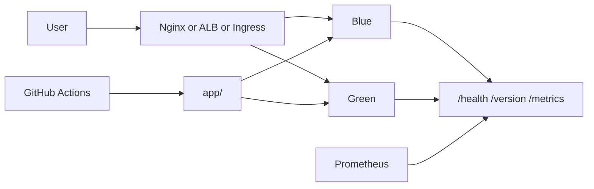

# DevOps portfolio

One small service, carried through the practices used to build, release, and operate it. `master` is the portfolio. Each folder is a piece of the same system, so the concepts connect.

The service is [`app/`](app/): `GET /health`, `GET /version`, and `GET /metrics`. Color and version come from the environment. That is the whole contract the load balancer, the blue-green script, Kubernetes, and Prometheus share.



## Projects

| | Practice | Where | What you can defend in an interview |
| --- | --- | --- | --- |
| 01 | Linux operations | [`projects/01-server-observability`](projects/01-server-observability) | A host snapshot with thresholds and a JSON mode, and why a script is not a monitoring system |
| 02 | Configuration management | [`projects/02-configuration-management`](projects/02-configuration-management) | Ansible roles, handlers, and idempotence for the same service under systemd and nginx |
| 03 | Infrastructure as code | [`projects/03-infrastructure`](projects/03-infrastructure) | Terraform modules: private subnets, ALB weights, IMDSv2, SSM instead of SSH, remote state locking |
| 04 | Blue-green releases | [`projects/04-blue-green`](projects/04-blue-green) | A cutover that refuses to move traffic until `/health` passes, plus an instant rollback |
| 05 | Kubernetes | [`projects/05-kubernetes`](projects/05-kubernetes) | Probes, requests and limits, HPA, PodDisruptionBudget, NetworkPolicy, selector-based cutover |
| 06 | Observability | [`projects/06-observability`](projects/06-observability) | Prometheus scrape, alert rules with a `for` duration, a dashboard stored in Git |
| 07 | GitOps | [`projects/07-gitops`](projects/07-gitops) | Argo CD application: Git as the source of truth, and why a `kubectl patch` is drift |

CI lives in [`.github/workflows/ci.yml`](.github/workflows/ci.yml). On every push and pull request it runs the unit tests, shell syntax, Ansible syntax, `terraform fmt` and `terraform validate`, a client-side Kubernetes apply, and the image build. [Pages](.github/workflows/pages.yml) publishes [`site/`](site/). [`terraform-plan.yml`](.github/workflows/terraform-plan.yml) is manual and assumes an AWS role with GitHub OIDC. It does not run until that role exists, and the repository does not contain cloud keys.

## Run the blue-green demo

```bash
make demo
./projects/04-blue-green/scripts/deploy.sh 1.4.0
./projects/04-blue-green/scripts/status.sh
./projects/04-blue-green/scripts/rollback.sh
make demo-down
```

Port `8080` is the proxy, the only address a user should hit. `8081` is blue and `8082` is green, left reachable so you can see the idle version. `deploy.sh` builds the new version on the idle color and reloads Nginx only after `/health` returns. `rollback.sh` points Nginx back at the color you just left, which is still running.

That is the same procedure as the AWS module, where it is a second Auto Scaling Group and a listener weight, and the same procedure as Kubernetes, where it is a second Deployment and a Service selector. The README in each project says what changes and what stays the same.

Other entry points:

```bash
make test
make stats
make observe          # Prometheus on :9090, Grafana on :3000, app on :8090
```

`make observe` uses Grafana admin password `admin` on localhost. It is a lab default.

## Scope

This is a personal lab, built so each design can be read and explained. The AWS stack is real Terraform and it is not left running: an Application Load Balancer and a NAT Gateway cost money while they exist, and the project README says to destroy them. Argo CD is represented by the Application manifest, not by a claim that a controller is installed. The local blue-green path, the tests, and CI are the parts that run here.

## Release strategies, in one place

- **Rolling** replaces instances inside one group. The Terraform Auto Scaling Group has an `instance_refresh` for this. You use less extra capacity, and you cannot return to the previous full set in one switch.
- **Blue-green** keeps two groups. Traffic moves in one step. Rollback is fast only while the old group is still up.
- **Canary** sends a fraction first. Set `canary_weight` in the Terraform variables. The Docker demo stays at 0 or 100 so `/version` makes the cutover obvious.
- **Data.** Both versions run during the switch. A schema change has to work for both: add the new shape, deploy, then remove the old shape.

## Earlier branches

The topic branches are the earlier exercises this portfolio grew out of. `server_performance_stats` and `gh-deployment-workflow` follow roadmap.sh projects. `configuration-management` and `IaC-localstack` were the first Ansible playbook and a local libvirt experiment. `master` replaces them as the version to read.
